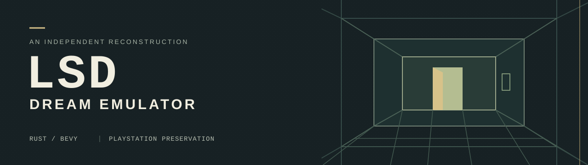
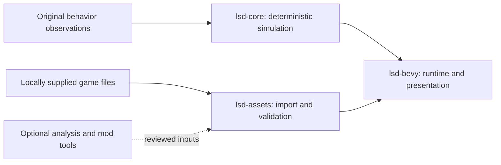

# LSD: Dream Emulator — Bevy Port

[](https://github.com/BaileyPillon/lsd-dream-emulator-bevy/actions/workflows/rust.yml)
[](LICENSE)
[](docs/STATUS.md)

A native desktop reconstruction of the original PlayStation game
**LSD: Dream Emulator**, written in Rust with Bevy. The project recovers its
simulation, scripted NPCs, asset formats, rendering, and audio through
comparisons with the original code.

**Development preview.** An explorable dream prototype, asset inspectors, and
deterministic compatibility tests are available. The complete game, including
its menus, movies, and save system, is still being reconstructed. There is no
stable binary release yet.

[**Read the handbook**](https://baileypillon.github.io/lsd-dream-emulator-bevy/) ·
[Getting started](docs/GETTING_STARTED.md) · [Project status](docs/STATUS.md) ·
[Roadmap](docs/ROADMAP.md) ·
[Contributing](CONTRIBUTING.md) · [Changelog](CHANGELOG.md)

## Start here

| Goal | Entry point |
| --- | --- |
| Explore the current desktop prototype | [Setup, local game files, and controls](docs/GETTING_STARTED.md#run-the-dream-prototype) |
| Build or contribute without game files | [Quick start](#quick-start) and [contributor workflow](CONTRIBUTING.md#development-workflow) |
| Understand what has been recovered | [Current status](docs/STATUS.md) and [subsystem evidence](docs/README.md) |
| Find the next implementation task | [Tracked milestones](https://github.com/BaileyPillon/lsd-dream-emulator-bevy/milestones) and [roadmap](docs/ROADMAP.md) |
| Choose a development tool or report a mismatch | [Developer reference](docs/DEVELOPMENT.md) and [compatibility reports](https://github.com/BaileyPillon/lsd-dream-emulator-bevy/issues/new?template=compatibility.yml) |

The [project handbook](https://baileypillon.github.io/lsd-dream-emulator-bevy/)
provides searchable setup guides, architecture, and recovery notes. Prefer
browsing the source? The same pages are indexed in [docs/](docs/README.md).

## Progress at a glance

| Area | Current implementation and evidence |
| --- | --- |
| [Original NPC scripts](docs/STATUS.md#what-currently-works) | **71 / 107** named callbacks implemented; 36 pending |
| [Content decoding](docs/ASSET_PIPELINE.md) | **418** maps, **98** streamed model libraries, **4,260** animation frames |
| [Audio imports](docs/AUDIO_IMPORT.md) | **9** sound banks, **351** tones, **255** samples, **70** sequences |
| [Dream runtime](docs/SHARED_FRAME.md) | Original-content prototype with movement, collision, links, generation, day progression, and live sound effects |
| [Music](docs/SEQUENCE_VOICES.md) | Original sequence and voice behavior recovered; controlled WAV synthesis works; live dream music is pending |
| Complete NPC encounters accepted | **0** |
| Whole-game feature groups accepted | **0 / 40** provisional groups |

Callback coverage is about **66.4%**. It measures individual script callbacks,
not completed encounters or game parity. There is no defensible overall
completion percentage yet. See [status and acceptance criteria](docs/STATUS.md).

## Quick start

The workspace pins **Rust 1.97.1** and **Bevy 0.20.0**, including its Cargo
lockfile. The default compatibility probe and headless tests need no game files.

```sh
git clone https://github.com/BaileyPillon/lsd-dream-emulator-bevy.git
cd lsd-dream-emulator-bevy
cargo test --workspace --locked
cargo run -p lsd-bevy --locked -- --steps 120 --seed 1
```

To run the desktop dream prototype with your own extracted game files:

```sh
cargo run -p lsd-bevy --bin lsd-stage --features desktop --locked -- "/path/to/extracted/files" 0 0 A --dream
```

The extraction root must contain the supported `SLPS_015.56` executable and
the `CDI` directory. Desktop builds need the platform dependencies described in
[Getting started](docs/GETTING_STARTED.md), which also covers controls and common
startup problems. Supply original game content locally.

| Platform | Automated coverage |
| --- | --- |
| Windows | Headless and audio tests, API documentation, desktop compilation |
| Linux | Headless and audio tests, API documentation |
| macOS | Not validated by the current CI matrix |

See the [CI workflow](.github/workflows/rust.yml) for the exact checks.
Desktop compilation and component tests have separate scopes from exercised
gameplay and original-game acceptance.

## Design



- **Original behavior:** explicit integer widths, RNG order, script state,
  collision rules, animation, and SDK/SPU behavior backed by reference checks.
- **Bevy presentation:** input, rendering, audio output, and development tools,
  with remaining PlayStation differences tracked explicitly.
- **Optional AI and mods:** a separate development track. The original
  experience has no dependency on AI accounts or generated NPC behavior.

| Crate | Responsibility | Code |
| --- | --- | --- |
| `lsd-core` | Deterministic simulation, original scripts, integer geometry, and SPU state | [Library](crates/lsd-core/src/lib.rs) |
| `lsd-assets` | Local format readers, reference validation, content binding, and scene adapters | [Library](crates/lsd-assets/src/lib.rs) |
| `lsd-bevy` | Headless host, desktop tools, rendering, input, and audio output | [Library](crates/lsd-bevy/src/lib.rs) |

Each library has an API overview with entry points and examples. Generate
browsable local docs with `cargo doc --workspace --no-deps --locked`; see the
[developer reference](docs/DEVELOPMENT.md#check-a-pull-request) for output paths
and feature-specific documentation.

See [architecture](docs/ARCHITECTURE.md) for implementation boundaries and
[the project objective](PROJECT_OBJECTIVE.md) for the full completion requirements.

## Development milestones

| Milestone | Exit criteria |
| --- | --- |
| [Playable dream preview](https://github.com/BaileyPillon/lsd-dream-emulator-bevy/milestone/1) | Reproducible import, live music, remaining NPC callbacks, and documented natural dream scenarios |
| [Complete game flow](https://github.com/BaileyPillon/lsd-dream-emulator-bevy/milestone/2) | Original menus, diary, save/load, movies, special days, and endings |
| [Reference parity acceptance](https://github.com/BaileyPillon/lsd-dream-emulator-bevy/milestone/3) | Original presentation and full-session comparisons across the reviewed feature inventory |

Milestones describe planned work and carry no release date. The
[roadmap](docs/ROADMAP.md) links the implementation tasks and acceptance gates.

## Contributing

Contributions are welcome in behavior recovery, asset formats, rendering,
audio, tooling, documentation, and reproducible comparison scenarios.
Read the [contributor guide](CONTRIBUTING.md), then open a
[bounded feature proposal](https://github.com/BaileyPillon/lsd-dream-emulator-bevy/issues/new?template=feature.yml)
or [bug report](https://github.com/BaileyPillon/lsd-dream-emulator-bevy/issues/new?template=bug_report.yml).

The [support guide](SUPPORT.md) routes setup questions and security reports.
[Maintenance and releases](docs/MAINTENANCE.md) describes review expectations and
the requirements for publishing a playable build.

## Attribution and license

This independent community project is not affiliated with the original game's
creators or rights holders. New project code is [MIT licensed](LICENSE);
original game content and third-party components retain their own rights.
See [NOTICE.md](NOTICE.md) for attribution and reference provenance.

The companion [matching C decompilation](https://github.com/BaileyPillon/lsd-dream-emulator-decompilation)
provides a separately tracked reference implementation. The port's recovery
and acceptance measurements are documented in [project status](docs/STATUS.md).

Game discs, executables, extracted assets, and PlayStation BIOS files are not
distributed by this repository.
