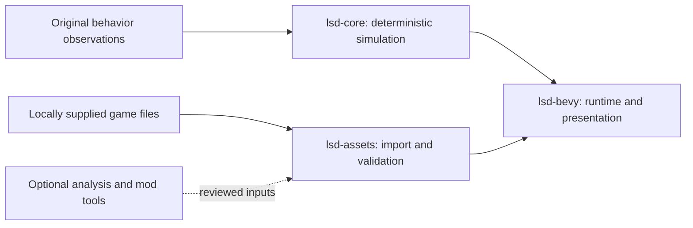

# LSD: Dream Emulator — Bevy Port

[](https://github.com/BaileyPillon/lsd-dream-emulator-bevy/actions/workflows/rust.yml)
[](LICENSE)
[](docs/STATUS.md)

A Rust and Bevy reconstruction of **LSD: Dream Emulator**, focused on preserving
the original PlayStation game's behavior, content, and presentation.

**This is a development project. A complete, playable replacement for the
original game is still in progress.** The desktop dream prototype, asset
inspectors, and compatibility tests are available for development and research.

[Getting started](docs/GETTING_STARTED.md) · [Project status](docs/STATUS.md) ·
[Roadmap](docs/ROADMAP.md) · [Documentation](docs/README.md) ·
[Contributing](CONTRIBUTING.md)

## Progress at a glance

| Area | Current evidence |
| --- | --- |
| Original NPC scripts | **71 / 107** named callbacks implemented; 36 pending |
| Content decoding | **418** maps, **98** streamed model libraries, **4,260** animation frames |
| Audio imports | **9** sound banks, **351** tones, **255** samples, **70** sequences |
| Runtime | Original-content dream prototype, movement, collision, links, generation, day progression, and live sound effects |
| Complete NPC encounters accepted | **0** |
| Whole-game feature groups accepted | **0 / 40** provisional groups |

Callback coverage is about **66.4%**. It measures individual script callbacks,
not completed encounters or game parity. There is no defensible overall
completion percentage yet. See [status and acceptance criteria](docs/STATUS.md).

## Quick start

The workspace pins **Rust 1.97.1** and **Bevy 0.20.0**. The default compatibility
probe and headless tests run without original game files.

```sh
git clone https://github.com/BaileyPillon/lsd-dream-emulator-bevy.git
cd lsd-dream-emulator-bevy
cargo test --workspace --locked
cargo run -p lsd-bevy --locked -- --steps 120 --seed 1
```

To run the desktop dream prototype with your own extracted game files:

```sh
cargo run -p lsd-bevy --bin lsd-stage --features desktop --locked -- "/path/to/extracted/files" 0 0 A --dream
```

The extraction root must contain the supported `SLPS_015.56` executable and
the `CDI` directory. Desktop builds need the platform dependencies described in
[Getting started](docs/GETTING_STARTED.md). No discs, executable, BIOS, or
extracted game assets are distributed here.

## Design



- **Original behavior:** explicit integer widths, RNG order, script state,
  collision rules, animation, and SDK/SPU behavior backed by reference checks.
- **Bevy presentation:** input, rendering, audio output, and development tools,
  with remaining PlayStation differences tracked explicitly.
- **Optional AI and mods:** a separate development track. The original
  experience has no dependency on AI accounts or generated NPC behavior.

See [architecture](docs/ARCHITECTURE.md) for the current boundaries and
[the project objective](PROJECT_OBJECTIVE.md) for the full completion requirements.

## Next milestones

1. Finish music playback and connect the original bank and sequence lifecycle.
2. Recover the remaining NPC callbacks and validate complete natural encounters.
3. Implement menus, diary, save/load, movies, special days, and endings.
4. Compare full sessions, rendering, audio, timing, and RNG history against the original.

The [roadmap](docs/ROADMAP.md) describes the work and its acceptance gates.

## Contributing

Contributions are welcome in behavior recovery, asset formats, rendering,
audio, tooling, documentation, and reproducible comparison scenarios.
Read [CONTRIBUTING.md](CONTRIBUTING.md), then open a
[bounded feature proposal](https://github.com/BaileyPillon/lsd-dream-emulator-bevy/issues/new?template=feature.yml)
or [bug report](https://github.com/BaileyPillon/lsd-dream-emulator-bevy/issues/new?template=bug_report.yml).

## Attribution and license

This independent community project is not affiliated with the original game's
creators or rights holders. New project code is [MIT licensed](LICENSE);
original game content and third-party components retain their own rights.
See [NOTICE.md](NOTICE.md) for attribution and reference provenance.

The companion [matching C decompilation](https://github.com/BaileyPillon/lsd-dream-emulator-decompilation)
is preserved and paused. Its **97.15% recovered-C byte coverage** is a separate
measurement and does not describe completion of this Rust port.
