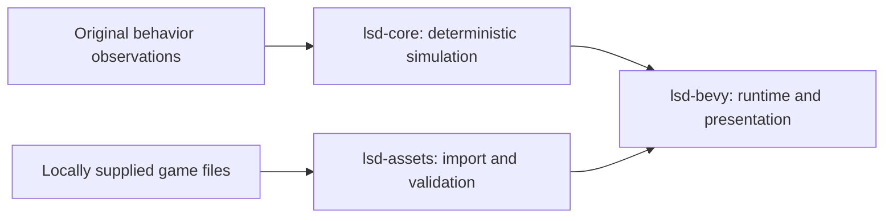

# LSD: Dream Emulator — Bevy Port

[](https://github.com/BaileyPillon/lsd-dream-emulator-bevy/actions/workflows/rust.yml)
[](https://github.com/BaileyPillon/lsd-dream-emulator-bevy/actions/workflows/docs.yml)
[](LICENSE)

An independent, native desktop reconstruction of **LSD: Dream Emulator**,
written in Rust with Bevy. The project recovers the PlayStation game's simulation,
scripted NPCs, content formats, rendering, and audio through reproducible
comparisons with the original code.

**Development preview.** You can explore a dream prototype with locally
supplied game files. Complete menus, movies, save/load, and live dream music
are still in progress. There is no stable binary release yet.

[**Handbook**](https://baileypillon.github.io/lsd-dream-emulator-bevy/) ·
[API reference](https://baileypillon.github.io/lsd-dream-emulator-bevy/API_REFERENCE/) ·
[Status](docs/STATUS.md) · [Roadmap](docs/ROADMAP.md) ·
[Modding](docs/MODDING.md) · [Contributing](CONTRIBUTING.md)

## Quick start

Install Git and rustup. The workspace selects **Rust 1.97.1** and pins
**Bevy 0.20.0** with a committed Cargo lockfile.

```sh
git clone https://github.com/BaileyPillon/lsd-dream-emulator-bevy.git
cd lsd-dream-emulator-bevy
cargo test --workspace --locked
cargo run -p lsd-bevy --locked -- --steps 120 --seed 1
```

These commands need no game files. The last command prints a deterministic
compatibility probe; select the desktop binary below to explore the prototype.

### Run the dream prototype

After installing the [desktop build dependencies](docs/GETTING_STARTED.md#requirements)
and preparing your own extracted Japanese reference files:

```sh
cargo run -p lsd-bevy --bin lsd-stage --features desktop --locked -- "/path/to/extracted/files" 0 0 A --dream
```

The extraction root must contain the supported `SLPS_015.56` executable and
`CDI` directory. With the window focused, **W/S** moves forward/back and
**A/D** turns. The [setup guide](docs/GETTING_STARTED.md) covers input validation,
platform dependencies, inspectors, and troubleshooting.

| Platform | Current automated coverage |
| --- | --- |
| Windows | Headless and audio tests, API documentation, desktop compilation |
| Linux | Headless and audio tests, API documentation, combined documentation site |
| macOS | Not validated by the current CI matrix |

See the [CI workflow](.github/workflows/rust.yml) for exact commands.
Desktop compilation does not establish exercised gameplay or original-game parity.

## Current state

| Area | Implementation and supporting evidence |
| --- | --- |
| [Dream runtime](docs/SHARED_FRAME.md) | Original-content prototype with movement, collision, links, generation, day progression, and live sound effects |
| [Original NPC scripts](docs/STATUS.md#what-currently-works) | **71 / 107** named callbacks implemented; **36** remain |
| [Content decoding](docs/ASSET_PIPELINE.md) | **418** maps, **98** streamed model libraries, **4,260** animation frames |
| [Audio imports](docs/AUDIO_IMPORT.md) | **9** sound banks, **351** tones, **255** samples, **70** sequences |
| [Music](docs/SEQUENCE_VOICES.md) | Controlled sequence-to-WAV synthesis; live dream music pending |
| Complete NPC encounters accepted | **0** |
| Whole-game feature groups accepted | **0 / 40** provisional groups |

The **66.4%** callback coverage measures individual script implementations.
Complete encounters and whole-game acceptance remain separate milestones;
there is no defensible overall completion percentage yet.
[Project status](docs/STATUS.md) explains the evidence and remaining gaps.
The [changelog](CHANGELOG.md) records development milestones.

## Mod support

The dream prototype supports opt-in data packs for maps, textures, models and
sound banks. Packs have hashed manifests, explicit load order, dependencies and
conflicts. Streamed destinations retain the active profile; original mode is
the default. See the [modding guide](docs/MODDING.md) for installation and authoring.

```sh
cargo run -p lsd-bevy --bin lsd-stage --features desktop --locked -- "/path/to/extracted/files" 0 0 A --dream --mod "/path/to/pack"
```

## Architecture



| Library | Responsibility | Reference |
| --- | --- | --- |
| [`lsd-core`](crates/lsd-core/src/lib.rs) | Integer math, RNG, dream sessions, NPC scripts, collision, animation, and software SPU state | [Simulation API](https://baileypillon.github.io/lsd-dream-emulator-bevy/api/lsd_core/index.html) |
| [`lsd-assets`](crates/lsd-assets/src/lib.rs) | Format readers, local import, reference validation, and content binding | [Content API](https://baileypillon.github.io/lsd-dream-emulator-bevy/api/lsd_assets/index.html) |
| [`lsd-bevy`](crates/lsd-bevy/src/lib.rs) | Engine integration, input, rendering, audio output, and development tools | [Host API](https://baileypillon.github.io/lsd-dream-emulator-bevy/api/lsd_bevy/index.html) |

Original NPC behavior belongs to the deterministic simulation. Optional
AI-assisted analysis and gameplay mods have a [separate development track](tools/ai-assist/README.md);
the original experience requires no AI accounts or generated NPC behavior.

Read [architecture](docs/ARCHITECTURE.md) for ownership and lifecycle boundaries,
[the developer reference](docs/DEVELOPMENT.md) for tools and Cargo features, and
[the subsystem index](docs/README.md) for recovery notes. The
[API guide](docs/API_REFERENCE.md) explains published coverage and local documentation builds.

## Roadmap

| Milestone | Exit criteria |
| --- | --- |
| [Playable dream preview](https://github.com/BaileyPillon/lsd-dream-emulator-bevy/milestone/1) | Reproducible import, live music, remaining NPC callbacks, and natural dream comparisons |
| [Complete game flow](https://github.com/BaileyPillon/lsd-dream-emulator-bevy/milestone/2) | Menus, diary, save/load, movies, special days, and endings |
| [Reference parity acceptance](https://github.com/BaileyPillon/lsd-dream-emulator-bevy/milestone/3) | Original presentation and full-session comparisons across the reviewed feature inventory |

Milestones carry no release date. The [tracked roadmap](docs/ROADMAP.md#tracked-work)
links scoped implementation tasks; [the project objective](PROJECT_OBJECTIVE.md)
defines completion.

## Contributing

Start with [CONTRIBUTING.md](CONTRIBUTING.md) for fork setup, code ownership,
checks, and comparison standards. Contributions are welcome in behavior
recovery, content import, rendering, audio, tools, and documentation.

Use a [bug report](https://github.com/BaileyPillon/lsd-dream-emulator-bevy/issues/new?template=bug_report.yml),
[compatibility report](https://github.com/BaileyPillon/lsd-dream-emulator-bevy/issues/new?template=compatibility.yml),
or [feature proposal](https://github.com/BaileyPillon/lsd-dream-emulator-bevy/issues/new?template=feature.yml)
for a focused change. See [support](SUPPORT.md), [security reporting](SECURITY.md),
and [maintenance and releases](docs/MAINTENANCE.md) for project policies.

## Attribution and license

New project code is [MIT licensed](LICENSE). Original game content and
third-party components retain their own rights; see [NOTICE.md](NOTICE.md).
This independent community project is not affiliated with the original game's
creators or rights holders. Game files and PlayStation BIOS images are supplied
locally and are not distributed here.

The companion [matching C decompilation](https://github.com/BaileyPillon/lsd-dream-emulator-decompilation)
is maintained separately. Its recovery percentage does not measure this port.
