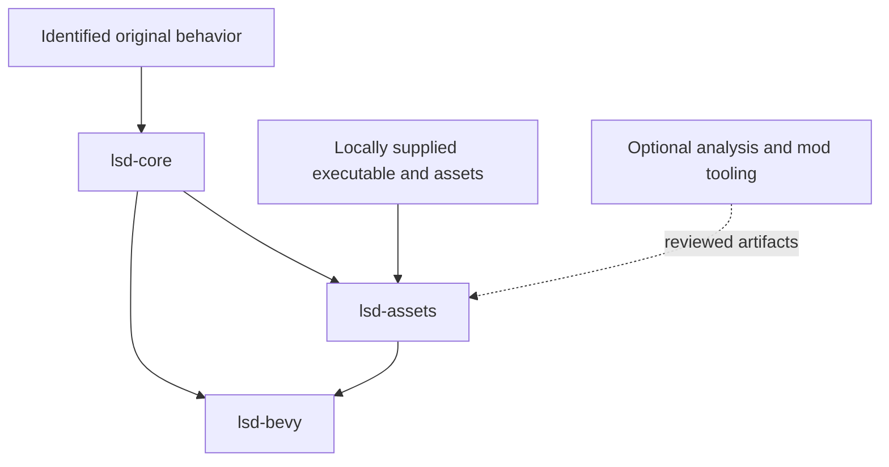

# Architecture

The port separates deterministic original behavior from engine presentation
and local reference inputs. Component tests can run without a GPU, game files,
network access, or an AI account.

| Component | Responsibility | Boundary |
| --- | --- | --- |
| `lsd-core` | Integer simulation, RNG, movement/collision, dream/day rules, actor scripts, transforms, SDK voice state, and SPU synthesis | No Bevy, filesystem, network, or AI dependency |
| `lsd-assets` | Bounded content decoding, canonical input validation, table import, scene adapters, and sequence/music adapters | Original files and reference data supplied locally |
| `lsd-bevy` | Runtime integration, input, meshes/materials, audio output, inspectors, and captures | Engine defaults do not establish original rendering or timing parity |
| `tools/ai-assist` | Reserved analysis and mod-authoring workflow | Optional, separately reviewed; no implemented model integration yet |

## Simulation and content

Original integer widths, signedness, wrapping, fixed-point math, RNG call order,
and callback order take precedence over host-engine convenience. The core
represents behavior and state; asset adapters bind local game content to it.

The running dream prototype shares scene clock, actor, player, link, generation,
and notification services. These connections have bounded comparisons; complete
natural loading, construction, cache, lifetime, and scheduling fidelity remains
an acceptance requirement. See [shared frames](SHARED_FRAME.md).

## Presentation and audio

Bevy presents imported content and exposes development tools. Integer geometry,
animation, palette, and screen-box logic retain recovered state. The remaining
PlayStation camera, raster, draw-order, blending, and timing differences stay
on the [roadmap](ROADMAP.md).

Sound requests share one voice pool, SDK register cache, sample RAM, and SPU.
The source produces continuous raw stereo PCM for Bevy output. Original music
voices use their own recovered sequence entry points into that shared driver;
they do not use a host MIDI synthesizer. Original bank lifecycle, full music
integration, and natural audio scene comparisons remain open.

See [live audio](LIVE_AUDIO.md), [sequence timing](SEQUENCE_CLOCK.md), and
[music voices](SEQUENCE_VOICES.md) for exact implementation and evidence scope.

## Optional AI and modifications

Original NPC behavior is deterministic recovered game logic. AI-assisted
analysis tools may produce reviewable artifacts with source identity and
provenance. New AI-driven gameplay belongs to explicitly selectable mods.
These tracks keep separate acceptance records and never silently change
canonical behavior. See [tools/ai-assist](../tools/ai-assist/README.md).

## Reference evidence

Owned fixtures run in public CI. Tests requiring original assets or detailed
native observations remain local and explicitly ignored by default. Component
checks, controlled integrations, and accepted natural scenarios are distinct.
See [reference identity](REFERENCE.md) and [project status](STATUS.md).
