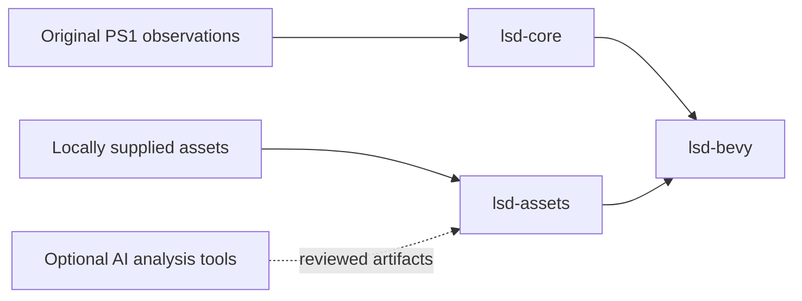

# Architecture

The port keeps integer simulation separate from Bevy presentation. This makes
original-behavior comparisons possible without a GPU, wall-clock scheduling or
an AI account.

`lsd-core` currently implements the PsyQ RNG, animation-word decoding and integer playback,
inclusive mixed-width cell bounds and valid stream-layer ordering. Future
movement, linking, dream generation and NPC scripts belong here. Recovered
fixed-point widths and overflow rules take precedence over floating-point
convenience.

Pad events, player look/turn/movement state, fixed SDK math, geometry queries
and collision-cloud preparation now also live in `lsd-core`. `ChunkPlayer`
connects them for a supplied loaded map. The full world/actor callback graph,
streaming and linking remain requirements; the chunk prototype is scoped in
[movement recovery](MOVEMENT_COLLISION.md).

`lsd-assets` validates PS-X EXE headers and the canonical executable hash, and
decodes TIM/TIX, TMD polygon objects, LBD maps and MOM/MOS/MML model libraries.
Typed owned geometry and ordered animation records, plus bounded borrowed
texture blocks, replace PS1 file pointers. Audio, movies and save-data decoding
remain open.

Math tables are read from the canonical local executable, and decoded TMD/LBD
data supplies collision geometry and tile poses. Raw tables and original
geometry stay local.

`lsd-bevy` exposes an explicitly stepped probe schedule and an optional desktop
preview and original-stage/model asset viewers. Original simulation cadence,
interpolation and rendering quirks need
reference evidence before their implementation. Bevy presentation defaults
do not automatically establish PlayStation visual parity.

AI-assisted analysis and mod creation will produce reviewable artifacts. They
will not run inside the default compatibility logic. Original NPC scripts and
new AI-driven NPC mods have separate implementation and acceptance tracks.
