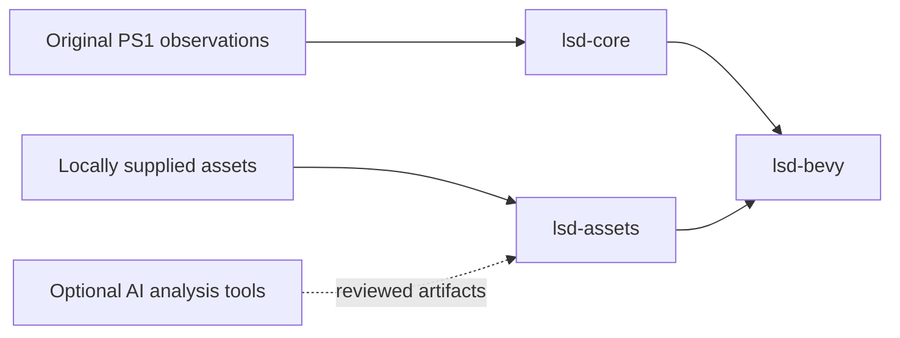

# Architecture

The port keeps integer simulation separate from Bevy presentation. This makes
original-behavior comparisons possible without a GPU, wall-clock scheduling or
an AI account.

`lsd-core` currently implements the PsyQ RNG, animation-word decoding,
inclusive mixed-width cell bounds and valid stream-layer ordering. Future
movement, linking, dream generation and NPC scripts belong here. Recovered
fixed-point widths and overflow rules take precedence over floating-point
convenience.

`lsd-assets` currently validates PS-X EXE headers and the canonical executable
hash. TIM/TMD, MOM/MOS, LBD/MML, audio, movies and save-data decoding remain
planned. Decoders will return bounded owned data rather than PS1 pointers.

`lsd-bevy` exposes an explicitly stepped probe schedule and an optional desktop
preview. Original simulation cadence, interpolation and rendering quirks need
reference evidence before their implementation. Bevy presentation defaults
do not automatically establish PlayStation visual parity.

AI-assisted analysis and mod creation will produce reviewable artifacts. They
will not run inside the default compatibility logic. Original NPC scripts and
new AI-driven NPC mods have separate implementation and acceptance tracks.
