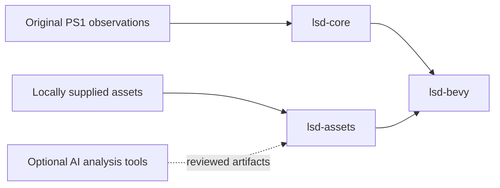

# Architecture

The port keeps integer simulation separate from Bevy presentation. This makes
original-behavior comparisons possible without a GPU, wall-clock scheduling or
an AI account.

`lsd-core` currently implements the PsyQ RNG, animation-word decoding and integer playback,
inclusive mixed-width cell bounds and valid stream-layer ordering. Future
world traversal, linking, dream generation and NPC scripts belong here. Recovered
fixed-point widths and overflow rules take precedence over floating-point
convenience.

Pad events, player look/turn/movement state, fixed SDK math, geometry queries
and collision-cloud preparation now also live in `lsd-core`. `ChunkPlayer`
connects them for a supplied loaded map. The full world/actor callback graph,
streaming and linking remain requirements; the chunk prototype is scoped in
[movement recovery](MOVEMENT_COLLISION.md).

`SceneSlots` adds original world/cell lookup and query selection. `SceneCollision`
connects ready slots to imported floor geometry and retains scene contact identity.
Layered inspection shares the player's integer control/motion path. Original
asynchronous loading and surrounding-body notification order remain requirements;
see [scene recovery](SCENE_RECOVERY.md).

`StreamGridTables` and `StreamProtocol` retain the original neighbor, slot-reuse
and request/completion rules. The asset crate's `StreamedStage` supplies host-file
completion and imported geometry; the viewer maintains resident meshes. Original
CD/actor callback behavior and scheduling remain open, with the captured native
boundaries documented in [stream recovery](STREAMING_RECOVERY.md).

`lsd-assets` validates PS-X EXE headers and the canonical executable hash, and
decodes TIM/TIX, TMD polygon objects, LBD maps and MOM/MOS/MML model libraries.
Typed owned geometry and ordered animation records, plus bounded borrowed
texture blocks, replace PS1 file pointers. Audio, movies and save-data decoding
remain open.

Math tables are read from the canonical local executable, and decoded TMD/LBD
data supplies collision geometry and tile poses. Raw tables and original
geometry stay local.

`lsd-bevy` exposes an explicitly stepped probe schedule and an optional desktop
preview and original-stage/model asset viewers. Original simulation cadence,
interpolation and rendering quirks need
reference evidence before their implementation. Bevy presentation defaults
do not automatically establish PlayStation visual parity.

AI-assisted analysis and mod creation will produce reviewable artifacts. They
will not run inside the default compatibility logic. Original NPC scripts and
new AI-driven NPC mods have separate implementation and acceptance tracks.

`DreamGeneration` owns the recovered generation selector and two persistent
proximity sound slots. `GenerationTables` and `GenerationPaths` import canonical
local content. The original sound scheduler targets a backend interface;
`GenerationAudioRequests` queues commands without claiming playback. The day
profile consumes scene choices and selected textures, while generated structures,
gradient rendering and the full generation RNG history remain incomplete. See
[generation recovery](GENERATION.md).

`EncounterTables` supplies the original chunk/day/color gates and ordered actor
spawn program. `ModelActor` creates the multipart animation rig and initial clip.
`EncounterScene` connects canonical local model libraries and entity properties
to streamed slots, retaining used flags across scene rebuilds. `StageLinkSession`
clears live actors on dream completion. The Bevy adapter maintains part parents,
mesh bindings, hidden mesh flags and palette updates; named callbacks remain
explicitly pending. See [encounter recovery](ENCOUNTERS.md).

`EntityBehavior` owns the original link/trigger/behavior state and `BehaviorContext`
owns the three sound slots. Its behavior counter, context counter and the
animation interpreter's interaction timer stay separate. `EntityTarget` provides
integer projection, height interpolation, proximity and facing-distance queries.
The asset adapter supplies loaded properties, the current player pose/view and
an independent actor sound queue. Twelve named callbacks are implemented; see
[entity behavior](ENTITY_BEHAVIOR.md) for the remaining catalog and timing work.

`ActorJournalDispatcher` handles notifications inside the emitting actor's
interaction update. `actor_journal` applies original mood/score, recall capture,
direct dynamic-link and video/end-clock policy with the shared RNG. The adapter
consumes newly emitted map-effect commands in the same host tick. Aim and
inherited geometry queries remain queued; full scene scheduling and media
playback remain open. See [actor journal recovery](ACTOR_JOURNAL.md).

`ModelActor` now retains the original movement halfword and pose setters.
Local-axis movement uses a signed halfword vector and the original rotation
matrix, followed by a synchronous notification when requested. `EntityScriptHost`
supplies rotation math and notification delivery to the callback interpreter.
The Bevy session supplies imported math tables; callers without motion services
receive an explicit fault for a script that requires them. See
[actor motion](ACTOR_MOTION.md) for the callback catalog and remaining body work.

`EntityBodyPlan` retains the original sender/type/link-stage gates and contact,
query, disable and notification order. `EntityBehavior::receive_body` invokes
the geometry backend and applies lifecycle consequences. `ModelActor` and the
day session retain separate actor and DreamSys contact identities. The journal
wrapper stores its inherited code-four contact before filtering, then bound
actor acknowledgements can deliver a recursive link/video/end notification in
the same call. `InheritedBodyQuery` explicitly records unfinished DreamSys
geometry work. See [entity body routing](ENTITY_BODY.md).

`ModelActor::collision_primitive` retains the geometry binding copied from the
root part at construction. `Mom::collision_model` imports that object's original
bounds and ordered triangle/quad faces. `SceneActor` keeps this geometry alongside
its animation rig. `CollisionModel::prepared_cloud` expands its bounds, extends
the moving side of the cuboid and applies a supplied cached world matrix using
the original saturated SDK arithmetic. Live query/response and native cache/
ancestry scheduling remain open; see [actor collision geometry](ACTOR_GEOMETRY.md).
